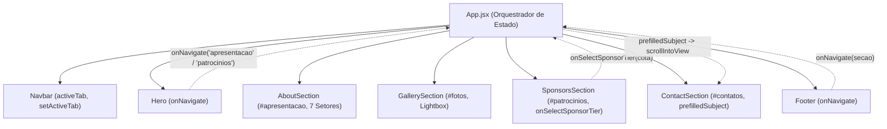

# 📐 Arquitetura do Sistema - Fórmula IF Puma Racing

## 1. Visão Geral

O site oficial da equipe **Fórmula IF Puma Racing** (IFBA Campus Jequié) foi concebido como uma aplicação web de alta performance, sem dependência de backends pesados ou frameworks de CSS utilitários com excesso de classes.

- **Padrão:** Single Page Application (SPA)
- **Framework:** React 18.3.1
- **Bundler / Dev Server:** Vite 5.4
- **Estilização:** CSS nativo puro com Design Tokens no escopo global (`:root`)
- **Acessibilidade:** Padrões WCAG 2.2 AA/AAA

---

## 2. Estrutura de Pastas e Componentes

```
Site FormulaIF/
├── public/                 # Ativos públicos não processados pelo bundler
│   ├── favicon.png         # Ícone em alta resolução
│   ├── favicon.svg         # Ícone vetorial leve
│   └── images/             # Fotos da equipe, logotipo e protótipo
│       ├── puma-logo.png
│       ├── puma-instagram.jpg
│       └── puma-feed.jpg
├── src/
│   ├── components/         # Componentes modulares com estilos isolados
│   │   ├── Navbar.jsx      # Barra de navegação com menu móvel e links
│   │   ├── Navbar.css
│   │   ├── Hero.jsx        # Seção principal de impacto com dados SECITEC
│   │   ├── Hero.css
│   │   ├── AboutSection.jsx # Pilares da equipe e navegador dos 7 setores
│   │   ├── AboutSection.css
│   │   ├── GallerySection.jsx # Galeria filtrável e modal Lightbox
│   │   ├── GallerySection.css
│   │   ├── SponsorsSection.jsx # Cotas de patrocínio e propostas
│   │   ├── SponsorsSection.css
│   │   ├── ContactSection.jsx  # Redes sociais, endereço e formulário
│   │   ├── ContactSection.css
│   │   ├── Footer.jsx      # Rodapé com mapa de links e dados acadêmicos
│   │   ├── Footer.css
│   │   └── Icons.jsx       # Biblioteca interna de SVGs acessíveis
│   ├── context/
│   │   └── AppContext.jsx  # Contexto React para estados globais futuros
│   ├── hooks/
│   │   └── useScroll.js    # Hook reutilizável de detecção de scroll
│   ├── services/
│   │   └── api.js          # Mock de dados e especificações técnicas
│   ├── App.jsx             # Componente raiz que orquestra a navegação
│   ├── App.css
│   ├── index.css           # Tokens de design, reset e classes utilitárias
│   └── main.jsx            # Ponto de entrada do React DOM
├── skills/                 # Guias técnicos de acessibilidade, UI e padrões
├── docs/                   # Documentação perene do projeto
├── index.html              # Shell HTML com pré-carregamento de fontes
├── package.json
└── vite.config.js
```

---

## 3. Fluxo de Navegação e Comunicação Entre Componentes



---

## 4. Tokens de Design (Design Tokens)

Definidos em `src/index.css`:

| Token | Valor Padrão | Aplicação |
|---|---|---|
| `--bg-primary` | `#070a11` | Fundo principal da página |
| `--bg-surface` | `#0f172a` | Superfície de cartões secundários |
| `--bg-card` | `#141e33` | Cartões interativos e áreas de destaque |
| `--color-primary` | `#e11d48` | Vermelho Crimson Racing (foco, ênfase e botões) |
| `--color-accent` | `#38bdf8` | Ciano de telemetria |
| `--text-primary` | `#f8fafc` | Texto principal de alto contraste |
| `--text-secondary`| `#94a3b8` | Texto explicativo e subtítulos |
| `--focus-ring` | `2px solid #e11d48` | Anel de foco WCAG para acessibilidade |

